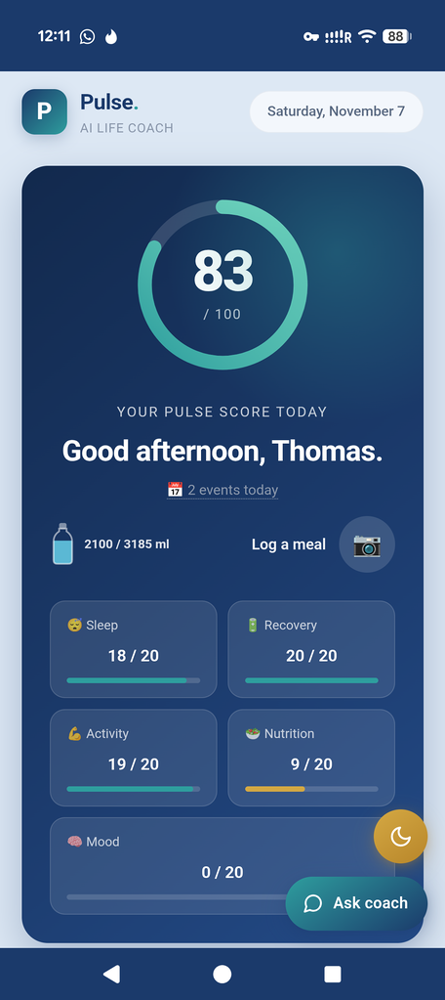
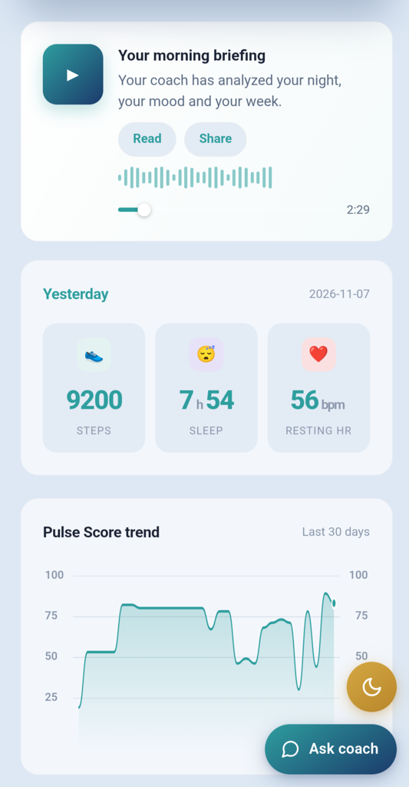
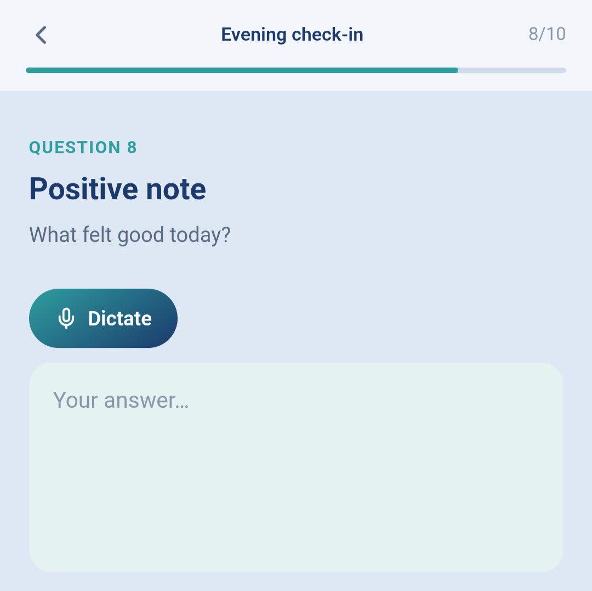
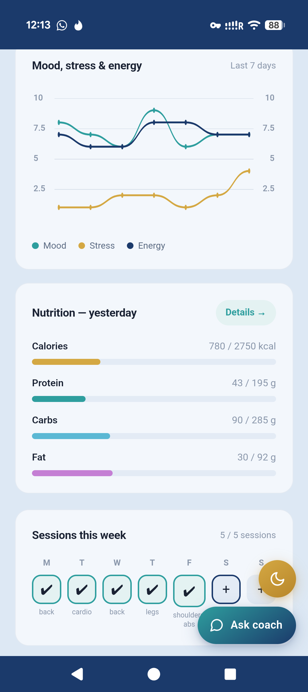
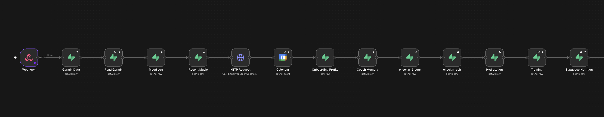
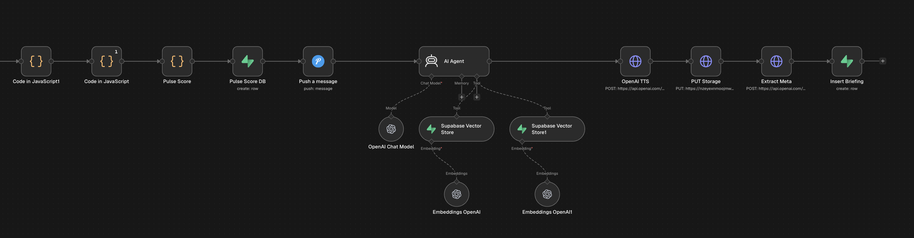
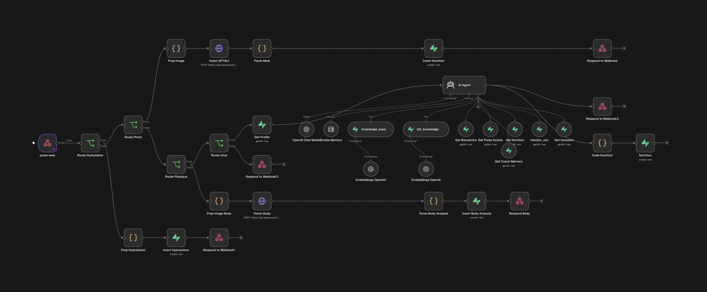

# Pulse AI Life Coach

A personal AI coach that cross-reads real Garmin biometrics with a psychological profile, and turns them into a daily spoken briefing, an evening check-in loop, a voice chat, photo-based meal and physique analysis, and a weekly review.

It is built around one idea: **a coach should remember, build on what worked, and notice the gap between what your body registered and how you felt.**

## How a day works

**Morning, automatic.** A scheduled script pulls last night's data from Garmin Connect and triggers the briefing workflow. The coach reads sleep, recovery, yesterday's training, meals and hydration, the weather, today's calendar and last night's check-in. It produces a spoken briefing with a state analysis, one concrete training and nutrition recommendation, one CBT technique, a stoic quote and a track suggested for the day. A push notification delivers the day's Pulse Score.

**During the day.** Photograph a meal or describe it to the coach, tap a bottle to log water, log a training session, weigh in, log your mood in real time, or talk to the coach by text or voice. Alerts fire if something drifts.

**Evening.** A push reminder opens a short check-in. The coach uses it tomorrow.

**Overnight.** Durable facts from the check-in are extracted into the coach's long-term memory.

**Weekly.** A longer questionnaire produces a written and narrated review of the whole period.

## Features

### Initial assessment and profile
Every user starts with a baseline built from clinically validated questionnaires, then a life and fitness profile.

- **PHQ-9** (depression), **GAD-7** (anxiety) and **PSS-10** (perceived stress), each stored with its score and severity level.
- **Life profile:** occupation, workload, 3-month goal, long-term dream, life satisfaction, motivation, confidence, clarity on goals, the area where the user feels blocked, how they react to difficulty.
- **Lifestyle:** sleep quality, tobacco, alcohol, dietary restrictions.
- **Fitness profile:** main sport, fitness level, fitness goal, age, height, weight, and reference performances (bench press, squat, pull-ups, push-ups).

This profile is read by the daily briefing, the chat and the weekly review. The weekly review compares its psychological scores to the baseline.

### Pulse Score
A daily score out of 100, split into five components of 20 points each:

| Component | Based on |
|---|---|
| Sleep | Garmin sleep score |
| Recovery | Body battery, overnight HRV and average stress, each scaled against the user's own recent range rather than generic thresholds |
| Activity | Steps and whether a training session was logged |
| Nutrition | Meal quality, distance to the calorie target (penalised in both directions) and protein ratio |
| Feeling | Mood, energy and stress from the evening check-in |

Every component comes with a one-sentence explanation, shown on tappable cards. If no check-in was submitted, the score is rescaled over the four measurable components instead of silently counting zero. A chart tracks the score over time.

### Garmin data
Collected daily: sleep duration, deep and REM sleep, sleep score, SpO2, sleep stress, overnight HRV, body battery, daily stress, resting heart rate, steps, moderate and vigorous intensity minutes, VO2 max.

### Daily voice briefing
- Generated by GPT-4o from the full day's context.
- Draws on two vector knowledge bases: one for training, nutrition and stoicism, one for CBT and coaching techniques.
- Includes a **stoic quote** and a **track recommendation** chosen from four moods (deep focus, recovery, energy, meditative), with a memory of recent picks so it does not repeat itself.
- Reads today's **Google Calendar** events and the **weather**.
- Takes into account whether the previous day's CBT technique was tried, and builds on it.
- Narrated with Cartesia Sonic text-to-speech. The player has a seek bar, duration, a live waveform on the actual audio, a full-text view and sharing.
- When the day's briefing is ready, a small gold "new" badge appears on the dashboard. Tapping it scrolls to the briefing and starts playback; it disappears once the briefing has been played and comes back with the next one.

### Meal tracking by photo or by chat
- **By photo:** take a picture of a meal. GPT-4o vision identifies the dish and returns calories, macros and micronutrients (vitamin C, vitamin D, iron, magnesium), plus a quality rating.
- **By chat:** describe what you ate to the coach, in text or by voice. It estimates the nutrition and logs the meal.
- A dedicated nutrition page shows an animated calorie ring, macro and micronutrient bars, per-meal cards with expandable detail and a date navigator. Meals can be deleted with a two-step confirmation.
- Yesterday's totals feed the Pulse Score and the next briefing.

### Hydration tracking
- A single tappable bottle logs 300 ml per tap, with a visual gauge and an instant, optimistic update.
- The daily goal is computed from body weight (35 ml per kg), with a bonus for training sessions and hot weather.
- Yesterday's total feeds the next briefing, and the average feeds the weekly review.

### Training
- Sessions are logged with the muscle groups trained, and can be edited or deleted. Cards show an icon per muscle group.
- The coach reads the muscle groups to recommend what to train next and never repeats a group trained in the last two days.
- Progress against the weekly target is judged by how much of the week has elapsed, so an empty Monday is not flagged as a shortfall.

### Body tracking and physique analysis
- **Body composition:** weight and body fat entry, editable targets, a two-axis progress chart with dashed target lines, history, and computed insights: weekly rate of change, projected date of reaching the target, and lean mass trend.
- **Physique analysis by photo:** upload a photo and GPT-4o vision returns a structured assessment: strengths, weak points, priority muscle groups and an overall comment on posture, symmetry and balance.
- The analysis is deliberately qualitative. The model is instructed never to estimate body fat or any other number from a photo, because a photo carries no signal for it.

### Evening check-in
- Mood, stress, energy and productivity on 0-10 scales.
- Dominant emotion, and whether anything triggered a disproportionate reaction (what happened, what set it off).
- Any recurring thought, and one positive point.
- Whether this morning's CBT technique was tried, and how useful it was (1-5).
- An optional note for the coach to remember.
- Free-text answers can be dictated by voice.
- A push reminder is sent each evening, with a different wording each time.

### Real-time mood log
A card on the dashboard logs how you feel at any moment of the day. The daily average is displayed, and the entries are passed to the next briefing.

### CBT loop
The coach proposes one technique in the morning. The evening check-in asks whether it was tried and whether it helped. The next briefing builds on that answer instead of switching technique every day: progression rather than variety. Over several days, the coach also looks for recurring thoughts and patterns in the check-ins.

### Long-term coach memory
Each night, durable facts are extracted from the day's check-in and filed as goals, blockers, decisions, techniques or context. Duplicates are merged and a counter tracks how often something comes back. The briefing and the chat both read this memory, so the coach can refer to something you said weeks ago.

### Voice chat
- Speak to the coach, get the answer spoken back with the same Cartesia voice as the briefings, or type.
- Speech-to-text with Whisper, a live level meter while recording, replay on each answer.
- The agent has access to the user's data through tools: biometrics, Pulse Scores, nutrition, check-ins and training sessions, plus the profile and a conversation memory.
- Meals described in the conversation are logged to the nutrition table.
- For emotional difficulty, the coach deliberately slows down: one question, then a reflection and a deeper question, then naming the thinking pattern, then reframing, then one small action. It does not solve everything in a single reply.

### Alerts
Alerts are separate automations that send a push notification.

- **Anomaly detection.** Runs daily and only notifies when something is really wrong, not on a bad day. Three signals are watched: overnight HRV, resting heart rate and body battery. Thresholds are derived from the user's own 30-day baseline, and an alert requires the threshold to be crossed **two days in a row**. The message shows the trajectory (yesterday's value, then today's).
- **Hydration alert.** In the afternoon, the workflow checks the day's logged water. If it is below 1,500 ml, a notification is sent while there is still time to catch up.
- **Evening check-in reminder.**
- **Daily score notification**, sent each morning with the Pulse Score.

### Weekly review
- A 20-screen questionnaire: short-form PHQ and GAD items, positive-affect questions, what was hardest, what worked, an overall rating, the perceived usefulness of CBT techniques, and the user's own goals for the coming week.
- The review window is rolling: it starts where the previous review ended.
- The coach aggregates sleep, HRV, stress, training, nutrition, hydration, Pulse Score trajectory, the CBT techniques proposed during the period, and every evening check-in.
- It writes a structured review: Pulse Score, sleep and recovery, training, nutrition and hydration, emotional trajectory, psychological state compared to the onboarding baseline, CBT techniques of the week, last week's goals (met or missed, judged from the data), the goals the user wrote, and a stoic reflection.
- It is narrated with Cartesia, stored, shared as a web page with an audio player, and announced by email. The audio duration is shown before playback starts.
- A summary card on the dashboard shows the latest review: the period, the user's own rating out of 10, and three scores out of 12 (wellbeing, low mood, anxiety). Each score is colour-coded on a simple personal scale: low mood and anxiety 0-3 good, 4-6 watch, 7-12 hard; wellbeing 9-12 very good, 5-8 fair, 0-4 low. The scale is a personal guide for tracking weeks, not a clinical threshold.
- When a new review is ready, a small navy and gold "new" badge floats on the dashboard until the review has been opened.
- The most useful signal is the gap between three sources: what the body registered (Garmin), how the days felt (check-ins) and the user's own judgement of the week.

## Screenshots

<table>
  <tr>
    <td align="center" valign="top"><b>Dashboard</b>  </td>
    <td align="center" valign="top"><b>Daily briefing</b>  </td>
  </tr>
  <tr>
    <td align="center" valign="top"><b>Evening check-in</b>  </td>
    <td align="center" valign="top"><b>Nutrition and training</b>  </td>
  </tr>
</table>

## Architecture

| Layer | Technology |
|---|---|
| Orchestration | n8n, self-hosted |
| Language model | OpenAI GPT-4o (briefings, chat, reviews), GPT-4o-mini (memory extraction), GPT-4o vision (meal and physique photos) |
| Voice | OpenAI Whisper for speech-to-text, Cartesia Sonic for narration (daily briefing, weekly review, chat) |
| Database | Supabase: Postgres, vector stores, file storage for audio |
| Frontend | Next.js, TypeScript, App Router, installable as a PWA, PIN-protected, deployed on Vercel |
| Health data | Garmin Connect, collected by a Python script run daily by a server cron job |
| Context | OpenWeatherMap, Google Calendar |
| Notifications | Pushover, email |

## Automations

| Workflow | Trigger | Role |
|---|---|---|
| Daily briefing | Called by the Garmin collection script each morning | Builds the score, writes and narrates the briefing |
| Interaction | Requests from the app | Routes chat, meal photos, physique photos, profile and hydration |
| Evening check-in | Check-in submitted | Stores the check-in |
| Coach memory extraction | Nightly | Extracts durable facts from the day's check-in |
| Check-in reminder | Evening | Push notification |
| Hydration alert | Afternoon | Push notification if intake is under 1,500 ml |
| Anomaly detection | Daily | Push notification after two consecutive days of abnormal biometrics |
| Weekly review | Questionnaire submitted | Aggregates the period, writes, narrates and stores the review |

## Workflows

The whole product runs on n8n. Each screenshot shows one workflow's canvas.

| Daily briefing (part 1) | Daily briefing (part 2) |
|---|---|
|  |  |

| Interaction (chat, photos) |
|---|
|  |

## Design decisions

- **Personal baselines over generic thresholds.** The recovery score and the anomaly alerts are calibrated against the user's own 30-day percentiles, because a generic scale would sit at zero, or never fire, for someone whose normal range is narrow.
- **Alerts must mean something.** The anomaly alert needs two consecutive days below threshold, so an isolated bad night does not trigger a notification.
- **Photos give structure, not numbers.** Meal photos return estimated nutrition for logging. Physique photos return a qualitative structural assessment only, never a body fat percentage.
- **Subjective data stays structured.** Check-in ratings are taps, not extracted from speech: they feed the score, so they must not be guessed by a model.
- **Honest about missing data.** No check-in or no Garmin data is reported as missing, never invented and never silently scored as zero.
- **Voice where typing is the friction.** Dictation is on free-text fields and chat, not on the numeric scales.
- **Time zones handled explicitly.** Every date window is computed in the user's local time zone, never raw UTC.

## Roadmap

- Monthly recap
- Smart scale and blood test import
- Other wearables through a health data aggregator
- Multi-user support with per-user data isolation

## Status

Personal project in active development. The source code is private.

This is not a medical device and does not diagnose anything. The questionnaires (PHQ-9, GAD-7, PSS-10 and their short forms) are used for personal trend-tracking only, not for clinical assessment.

## Contact

Thomas Plasseraud, AI automation consultant at FlowsOps AI.
[LinkedIn](https://www.linkedin.com/in/thomas-plasseraud)
